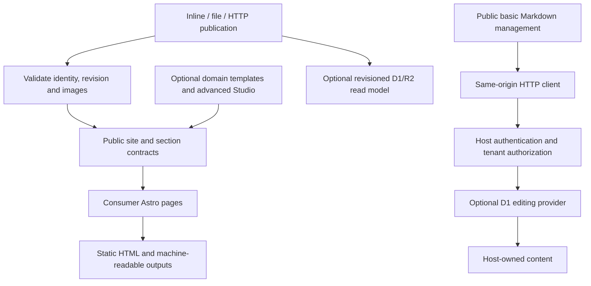

# SiteKit Architecture

## Motivation

A site should keep the same content contracts when its CMS or hosting changes. The public core therefore owns configuration, normalized content/media, sections and build inputs. Hosts choose a publishing authority, authentication and deployment separately.

Each build reads one publication. Its identity, expected revision and image bytes are checked before page rendering, preventing a mixture of content and media revisions. Inline snapshots, files and HTTP endpoints share this path.

## Architectural Diagram

## Trade-offs & Decisions

### Integration terms

EAOS is an optional external content-management ecosystem supported by compatibility contracts; an independent SiteKit site does not require its account or SDK. In extension documentation, private means a separately distributed implementation. A content record whose visibility is `private` instead describes delivery policy; it is not a package dependency. Generic public schema SQL provisions a consumer-owned database and contains no production/customer database contents.

### One content authority

Upstream-managed content and rebuildable projections are different responsibilities. When a publishing system owns content, its D1/R2 projection must not become a competing editor. An independent host can instead select its own D1 authoring provider. The editing provider marks document states; it does not trigger a production deployment or manufacture a publication snapshot.

### Useful basic management with separate advanced extensions

The public screen supplies list/search, Markdown fields, draft saving and publishing. Its host injects persistence and server authorization. The private wrapper can supply a richer editor without changing the public screen. Advanced editing, integrated campaign/experiment/social dashboards and domain-specific presentation remain outside the public candidate. Basic usability is not intentionally withheld to create an upgrade requirement.

### Static pages with explicit server boundaries

The default site output is static. Editing, payments and analytics require explicit server handlers and bindings. Browser imports must not load database SDKs, filesystem access or backend credentials. Provider contracts allow a host to replace an adapter without duplicating the build system.

### Image integrity versus migration compatibility

Rendering uses locally pinned, verified image bytes. Build authentication headers are not forwarded to media origins. The original publication remains available for receipt comparison. A compatibility option can accept older publications without hashes, but supplied hashes are still checked and a publication declaring SHA-256 integrity cannot use that exception.

### Metadata is not authorization

Visibility and offer metadata are portable contracts. AI projection can omit restricted bodies while retaining metadata; search can include restricted records unless the host filters them. Neither operation grants access. Authenticate users and enforce access before returning content or creating a build intended for a narrower audience.

### Documentation ownership

This project owns the English source guides, examples, public import declarations and JSDoc. Package READMEs stay plain Markdown; a small local script adds metadata to generated landing documents. `docs.manifest.json` selects the exact documents and source entrypoints available to the downstream portal.

The portal owns navigation, rendering, translations and generated API presentation. Its verify-only importer can check this project's manifest without importing or publishing it. Internal plans, customer/operator evidence, credentials and historical archives are outside the public manifest. See [extension boundaries](extensions.md) and [source verification](guides/verify-source.md).
