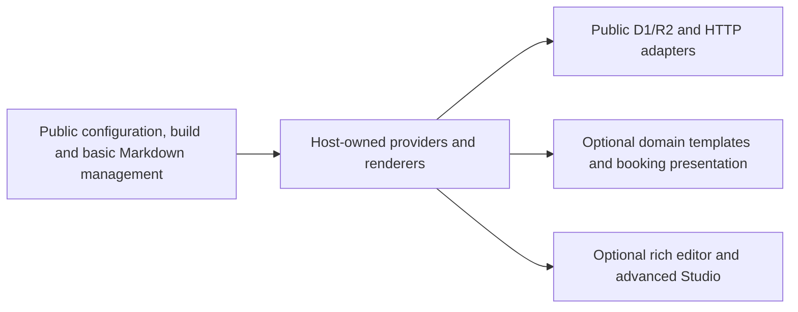

# Public Foundations and Optional Extensions

## Motivation

An independent site must be configurable and its basic content manageable without a private CMS SDK. At the same time, a reusable hotel experience or integrated operational dashboard can be a separate product. Technical availability in a public dependency does not automatically make every composition part of this framework's public scope.

## Architectural Diagram

## Trade-offs & Decisions

| Public foundation | Optional extension boundary |
| --- | --- |
| Configuration, publication loading and static build | Domain-specific routes, layouts and complete visual presets |
| Basic list/search, Markdown editing, draft save and publish | Rich block editing and integrated operational workflows |
| Host/provider interfaces and metadata conversion | Integrated analytics, experiments and social publishing UI |
| Generic persistence/event adapters | Host-specific operational composition and deployment tooling |

The public contract leaves room for paid extensions. Product scope, pricing and availability are not established by this guide. Generic adapters are integration primitives, not a promise of a complete operational service.

The public package does not export the full legacy Studio barrel, Site Studio or restricted BlockNote wrapper. Use the documented [public subpaths](exports.md); a source directory or an old package name does not imply a supported import.

For basic management, use the [tutorial](tutorials/basic-admin.md) or [integration guide](guides/public-studio.md). Production authentication, tenant authorization and deployment remain host responsibilities. These extension boundaries are distinct from confidential material: customer data, credentials, operator receipts and unreviewed dependency archives are never public documentation inputs.
